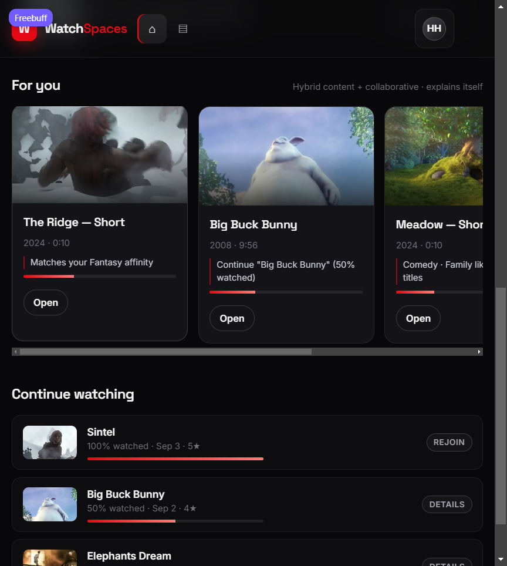

# WatchSpaces

**AI-orchestrated social watch parties.** A full-stack MERN reference implementation of the Netflix *AI-Driven Hyper-Personalized Interactive Content & Social Watch Spaces* brief: synchronized playback, a retrieval-grounded scene co-pilot, live trivia, group votes on pre-approved narrative/localization variations, and a hybrid recommender — all backed by an authoritative realtime room runtime.

> The original product brief is preserved at [docs/PROJECT_BRIEF.txt](docs/PROJECT_BRIEF.txt).

---

## What works

| Capability | Implementation |
| --- | --- |
| **Synchronized watch parties** | Socket.io rooms; the server owns the playback clock. Hosts send intent (`play`, `pause`, `seek`); participants measure drift every 4s and are corrected with a 5% rate nudge (soft) or a seek (hard). |
| **Live AI co-pilot** | Retrieval over the authored title timeline around the playhead, with TF-IDF ranking, intent boosts, a coverage floor and mandatory citations. Off-timeline questions are declined, not answered from general knowledge. Optional OpenAI-compatible phrasing with deterministic fallback. |
| **Contextual trivia** | A server-side ticker watches the playhead crossing authored markers and emits trivia once per room, respecting room verbosity (`minimal` / `normal` / `chatty`). |
| **Variation voting** | Hosts open a vote at an authored variation point; members cast one ballot each; results are tallied live and the winning pre-approved caption/framing is applied to every screen. Nothing is generated at watch time. |
| **Personalized recommendations** | Hybrid content-based + item-item collaborative + popularity blend with per-item explanations, leave-one-out evaluation and an admin retrain endpoint. |
| **Host failover** | If the host drops, playback pauses immediately. After a grace period the longest-present participant is promoted and the room is told to resume manually. |
| **Session analytics** | Join/leave/chat/AI/trivia/vote events are logged and reconciled against cached counters in a host-only session report. |
| **Auth & RBAC** | JWT access tokens + rotating refresh tokens, bcrypt hashes, `viewer` / `host` / `admin` roles, room-scoped host checks, Zod validation, Helmet, rate limits. |
| **Admin studio** | Browse titles, edit timeline JSON, run server-side validation with path-level errors, publish metadata live to open rooms, manage roles, retrain/evaluate the recommender. |

---

## Stack

- **Node.js 20 + Express 4** — REST API, JWT auth, RBAC, Zod validation.
- **Socket.io 4** — room state, presence, chat, trivia, votes, playback sync.
- **MongoDB + Mongoose 8** — users, titles with embedded timelines, rooms, votes, chat, interactions, session events.
- **React 18 + Vite 5 + React Router 6** — SPA with a custom dark design system.
- **Jest 29 + Supertest + socket.io-client** — 60 automated tests across 8 suites.
- **No required external services** — with no `MONGODB_URI`, the server starts an embedded `mongodb-memory-server` instance, so `npm install && npm run dev` is enough for a demo.

---

## Quick start

Requirements: **Node.js ≥ 20** and npm. (Developed and verified on Node 20.20 / Windows, npm workspaces.)

```bash
npm install
npm run dev
```

- SPA: <http://localhost:5173>
- API: <http://localhost:4000>
- Health: <http://localhost:4000/api/v1/healthz> · Readiness: <http://localhost:4000/api/v1/readyz>

### Changing ports

The API listens on `PORT` (default **4000**) and the SPA on `VITE_PORT` (default **5173**). If 4000 is already taken on your machine, set `PORT` in the root `.env` and start again:

```bash
# .env at the repo root (not committed)
PORT=4100
```

The client proxy reads the same `.env`, so `npm run dev` then serves the SPA on 5173 against the API on 4100 with no other change. If the server cannot bind its port it exits with a `port_in_use` message naming the port and the fix, rather than leaving the SPA pointed at whatever else owns that port.

On first start the server seeds an idempotent demo dataset: three open-licensed films, three short excerpts, authored timelines (beats, characters, glossary, trivia, variation points), demo users, interactions and a scheduled room.

### Demo accounts

| Role | Email | Password | What they can do |
| --- | --- | --- | --- |
| Host | `host@watchspaces.dev` | `Host123!` | Create/run rooms, control playback, open votes, view reports |
| Viewer | `viewer@watchspaces.dev` | `Viewer123!` | Join rooms, chat, ask the co-pilot, vote |
| Admin | `admin@watchspaces.dev` | `Admin123!` | Everything above + metadata studio, roles, retrain |

The login screen has one-click buttons for these accounts.

### Useful scripts

```bash
npm run dev          # API + Vite together
npm run seed         # re-seed (idempotent)
npm test             # 8 Jest suites, 60 tests
npm run build        # production SPA build
npm start            # API, serving client/dist when present
npm run eval:recs    # leave-one-out recommender report
npm run loadtest -- 120 12
```

To use a real MongoDB, copy `.env.example` to `.env` and set `MONGODB_URI`. Never commit `.env`.

---

## Try it in five minutes

1. Sign in as **Host**, open **Browse**, pick **Sintel**, choose *Create & enter room*.
2. Copy the invite link and open it in a second browser profile; sign in as **Viewer**.
3. Host presses play. Both players stay together; the viewer cannot control playback.
4. Ask the co-pilot **“Who is Sintel?”** — it answers with citations. Ask **“Who won the 2022 World Cup?”** — it declines.
5. Open **Variants**, start the subtitle vote, vote from both windows, then close it. The winning pre-approved caption appears on both screens.
6. Close the host tab and wait ~15s: playback pauses immediately and the viewer is promoted to host.
7. Re-open the room as the new host and view **Session report**; counters reconcile with the event log.

---

## Architecture at a glance

```
React SPA ──HTTP /api/v1──▶ Express (auth, RBAC, REST)
    │                          │
    └──Socket.io /socket.io────┤
                               ▼
                    Room runtime (in memory)
                    • authoritative playback state machine
                    • presence + host failover
                    • trivia ticker over the authored timeline
                    • vote timers and broadcasts
                               │
                ┌──────────────┼───────────────┐
                ▼              ▼               ▼
          MongoDB        Grounded AI       Recommender
        (durable data)   (retrieval)      (hybrid, cached)
```

Deep dives: [docs/ARCHITECTURE.md](docs/ARCHITECTURE.md) · [docs/API.md](docs/API.md).

### Playback synchronization

`server/src/services/playbackStateMachine.js` is a pure state machine: `idle → playing ⇄ paused`, with transient `seeking`/`buffering` that resume to their previous status. Positions are derived from `updatedAt` only while playing. `roomRuntime` adds the room clock, revision counter, 20 events/s host rate limit, and a 300ms seek settle. Clients apply snapshots idempotently; non-hosts ping `/room.sync.ping` every four seconds and get a correction decision:

| Drift | Action |
| --- | --- |
| ≤ 250 ms | none |
| 250–1200 ms | `playbackRate` 1.05 / 0.95 for ~4.5 s |
| > 1200 ms | hard seek to the authoritative position |

The host’s play/pause call happens inside the click gesture so browsers allow media playback; the server broadcast then acts as confirmation.

### Grounded co-pilot

1. Build a corpus from the title synopsis, characters, beats, trivia, glossary and variation options.
2. Tokenize the question, remove stopwords, detect intent (`who`, `glossary`, `variation`, `when`, generic).
3. Score entries with TF-IDF, tag boosts and a recency decay around `currentTs`; never retrieve events that have not played.
4. Ground only when the top entry clears `AI_MIN_SCORE` **and** either covers ≥ `AI_MIN_COVERAGE` of the question’s content terms or matches the detected intent’s entry type.
5. Compose a deterministic answer from the top entries and return their ids as citations. An optional LLM may rephrase, but its output is rejected unless it cites retrieved ids; otherwise the deterministic answer is used.

### Variations are pre-approved

`variation_point` timeline events carry 2–3 authored options with optional localized subtitles. `voteService` opens a timed vote, aggregates ballots, emits `voteUpdate` on every ballot, closes automatically or on host command, and broadcasts the winning option. The client renders the winning subtitle/framing; no free-form text is ever generated or written back to the title.

### Recommender

`recommendationService` builds a TF-IDF genre/tag vector per title, item-item cosine similarity from co-watch behaviour, and a popularity prior: **0.60 content + 0.35 collaborative + 0.05 popularity**. Completed titles are excluded; partially watched titles are down-weighted. Every rail item carries human-readable reasons (affinity match, co-watch, popularity, continue). The model is cached and invalidated when an interaction is recorded.

---

## Verification (measured, not estimated)

Run `npm test` (Jest, Node 20, embedded Mongo):

```
Test Suites: 8 passed, 8 total
Tests:       60 passed, 60 total
Time:        24.377 s
```

Covered: state machine transitions/drift, timeline validation, grounding and refusals, REST RBAC, socket permissions and broadcast, vote tally/apply, host failover, analytics reconciliation, recommender ranking and cache invalidation. Details and manual evidence: [docs/TEST_REPORT.md](docs/TEST_REPORT.md).

**Recommender evaluation** — `npm run eval:recs` on the seeded catalogue: precision@5 **1.00**, recall@5 **1.00**, 9 evaluated users, 27 interactions, 6 titles, 83 ms model build. This is a smoke-level result on a tiny authored catalogue, not a production benchmark.

**HTTP load test** — `npm run loadtest -- 120 12` (dashboard read path, local MongoDB, single Node process, Supertest, request logging disabled):

| Requests | Concurrency | p50 | p95 | p99 | Throughput |
| --- | --- | --- | --- | --- | --- |
| 120 | 12 | 542 ms | 801 ms | 826 ms | 20.9 req/s |

These numbers include JWT verification and several Mongo queries per dashboard load; they are a local baseline, not a capacity claim.

---

## Deployment notes

The app is a single Node process by design in this build:

- Build the SPA (`npm run build`); Express serves `client/dist` and keeps `/api` + `/socket.io` on the same origin.
- Set `NODE_ENV=production`, `MONGODB_URI`, a real `CLIENT_ORIGIN`, and unique 32+ character JWT secrets. The server refuses to boot in production with the insecure defaults.
- Terminate TLS at a reverse proxy that forwards WebSocket upgrades for `/socket.io`.
- Room state, trivia timers, vote timers and the host grace timer live in memory. For more than one instance, move the room runtime to a shared store and add the Socket.io Redis adapter with sticky sessions, or shard rooms by `watchSpaceId`. The PRD explicitly allows this single-worker assumption; it is documented rather than hidden.

---

## Project layout

```
client/
  src/pages/          Auth, Dashboard, Browse, Room, Admin
  src/components/     VideoStage, ChatPanel, CoPilotPanel, VariationPanel, Shell…
  src/lib/            API client + refresh, auth context, socket helpers, formatting
server/
  src/models/         User, Title, WatchSpace, Vote, ChatMessage, Interaction…
  src/services/       playbackStateMachine, roomRuntime, aiEngine, voteService,
                      recommendationService, analyticsService, timelineService
  src/routes/         auth, titles, watchSpaces, engagement, admin, health
  src/sockets/        authenticated Socket.io gateway
  src/seed/           authored catalogue, timelines, demo users/interactions
  tests/              8 Jest suites (60 tests)
  scripts/            seed, recommender evaluation, load test
docs/                 architecture, API reference, test report, project brief
```

---

## Media & attribution

All sample films are Blender Foundation open movies released under **Creative Commons Attribution 3.0**: *Sintel* (2010), *Big Buck Bunny* (2008), *Elephants Dream* (2006). The timelines (scene markers, trivia, character notes, glossary, variation options) are authored for this project; timestamps are approximate scene markers, which the brief permits. This is an independent engineering demo and is not affiliated with Netflix.

### How the video actually reaches the browser

Every title has a `videoAssetUrl` and the three short titles also have `fallbackAssetUrl`:

| Title | Primary source | Fallback |
| --- | --- | --- |
| The Ridge — Short, Meadow — Short, Drift | `server/public/media/*-10s.mp4` (committed, served by the API at `/api/v1/media/…`) | — |
| Sintel, Big Buck Bunny, Elephants Dream | the Internet Archive | the matching committed 10-second clip |

Each title also has a poster frame at `server/public/media/posters/<slug>.jpg`, extracted from the film itself and committed, served from the API origin at `/api/v1/media/posters/…`. Cards, room thumbnails and the player's `poster` attribute all use it. It is a deployment fact rather than editorial content, so the seed reconciles poster and media URLs for existing titles on every boot — a database seeded before the posters existed picks them up without a wipe. These were added after the catalogue shipped `posterUrl: ''` and every card rendered a blank tile with just the title's initials.



The three short clips (~1 MB each) are committed and served from the API origin, so those rooms always play — offline, behind a firewall, on any ISP. The three full films need archive.org, which several networks block. The player falls back to the local clip in three cases, because a blocked or throttled host does not always raise an error:

1. the stream errors (`onError`),
2. it delivers no metadata within 8 seconds, or
3. **it stalls mid-playback** — metadata and a first frame arrive, then the bytes stop while the room clock runs. This is the case that looks like "the video does not play": a frozen picture with no error at all. If the element stops advancing for ~12 seconds with a starved buffer, the bundled clip takes over.

On fallback the clip loops and the stage shows a **Sample clip** badge, while the room clock, trivia, votes and co-pilot keep running off the authored timeline. If both sources fail, the overlay names the URL it tried and offers **Retry** — a `/api/v1/media/…` failure there means the SPA is not reaching this API (see [Changing ports](#changing-ports)). Sample-clip rate/caption credits: [test-videos.co.uk](https://test-videos.co.uk/).

To check every catalogue asset at once (server up, then):

```bash
npm run --workspace server check:media
```

It prints the HTTP status and content type for each title's primary and fallback source and exits non-zero only on a failing primary.

If a stage still shows nothing, it is a genuine double failure (no upstream and no local file) — check the clip straight from the API, using your configured `PORT` (the command below assumes the 4000 default; my own demo ran on 4300):

```bash
curl -sI http://localhost:4000/api/v1/media/sintel-10s.mp4   # expect 200 video/mp4, Accept-Ranges: bytes
```

A `404 {"message":"Endpoint not found"}` there means you are talking to a different process on that port, not to this API — see [Changing ports](#changing-ports).

## Limitations

- No DRM or real Netflix catalogue integration; playback uses open-licensed HTTP video.
- The three full films stream from archive.org. Networks that block it get the bundled 10-second sample clip instead, so the picture is not the full film there (the timeline-driven features are unaffected).
- Room clocks and timers are process-local (single instance).
- The co-pilot’s default provider is a deterministic grounded synthesizer; an LLM key is optional and only rephrases retrieved evidence.
- The recommender is deliberately small and transparent; its perfect leave-one-out score reflects a 6-title demo catalogue.
- Admin role changes are not restricted from demoting the last admin — a production deployment should add that guard.
